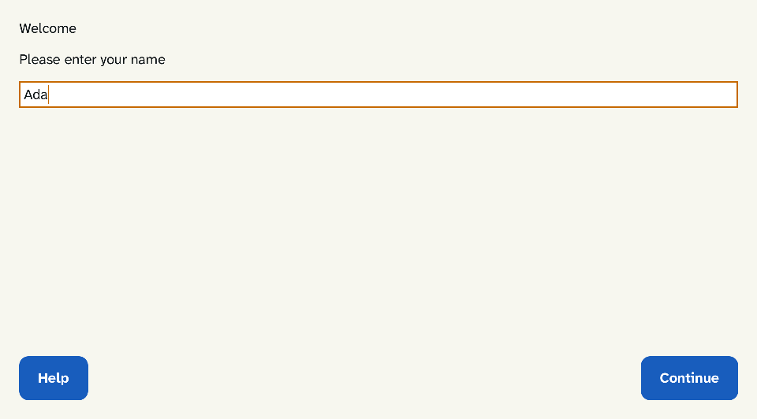

# NoWayOS

**The Single Purpose OS: a computer with nothing else to do, on seL4, in Rust.**

> No way to exploit what was never built in.

Most devices that do one job (a kiosk, a terminal, a control panel) run an
operating system built to do everything: a general-purpose kernel, a desktop,
a web browser, a package manager and a shell, then settings to lock it all
down. Every one of those is code an attacker can use and an operator has to
patch.

NoWayOS starts from the other end. You write your application in Rust;
NoWayOS builds it, with only the drivers it uses, onto the
[seL4](https://sel4.systems) microkernel. The image that comes out holds that
and nothing else. There is no browser engine, window system, shell, package
manager or user account: none was ever built in, so none is there to exploit,
patch or misconfigure.



## Why NoWayOS

### More secure

- **Less to attack.** What is not in the image cannot be used against it.
- **Sealed compartments.** The screen, the input, the network and your
  application each run in a protection domain of their own on seL4, a
  microkernel of about 10,000 lines with mathematical proofs of correctness
  and security for specific configurations. A part reaches only what its
  system description grants it, so a bug in one part stays in that part.
- **Rust throughout.** Microsoft and Google have each reported that around
  70% of their serious security bugs are memory-safety errors, the kind Rust
  rules out. Every protection domain is Rust, and `unsafe` code is allowed
  only in a handful of reviewed crates, a list `make ci` enforces.
- **Input is hostile until checked.** Every message between compartments is a
  fixed-size, versioned record, copied out of shared memory before it is
  checked. Every parser of outside input is fuzzed, and built never to panic.

### More efficient

- **Nothing idle.** No background services and no updater for software you
  never use: the device starts into its one job.
- **Memory fixed at build time.** Device code allocates nothing; every buffer
  and queue has a set size. The one exception, the TLS client, works in a
  fixed arena of its own.
- **A light, native UI.** Drawn with `embedded-graphics`, repainting only what
  changed, with anti-aliased text from glyph atlases made at build time.
- **Low-cost hardware.** Built for the Raspberry Pi 5, as well as QEMU.

### Easier to work with

- **One language,** Rust, from the drivers to the user interface.
- **One container.** The Rust toolchains, the Microkit SDK and QEMU are pinned
  in a dev container; your machine needs only Podman and `make`.
- **Emulator first.** Every system boots in QEMU and checks its own output
  before it touches hardware.
- **Screens your way.** Build them in Rust with a small declarative UI core,
  or design them in React and convert them with
  the [Screen Compiler](https://github.com/NoWayOS/screen-compiler).
- **Clean input.** Applications see key, pointer and touch events, never USB
  or other device protocols.

### Easier to prove

- **Every grant written down.** Each system lists every capability it grants
  in a `.grants` file, checked against the build. Isolation tests try to
  reach what they were not given, and seL4 must stop them; a variant with a
  grant widened on purpose must fail.
- **Every image itemised.** A CycloneDX SBOM for every workspace and every
  system image: the kernel, the loader, each protection domain and the crates
  in it, each with its hash.
- **The evidence runs in `make ci`.** Kani proofs of every IPC record decoder, with
  mutation checks that show the proofs can fail; fuzzing; Miri over the
  `unsafe` crates; licence and advisory checks; a secrets scan; and the exact
  seL4 configuration of every image recorded beside it, so nobody has to take
  "verified" on trust.

## What's inside

| Area | What NoWayOS gives you |
| --- | --- |
| Runtime | Protection-domain patterns on Microkit and rust-sel4; a supervisor that stops a faulted part and restarts the system clean, with a fail-safe state after repeated faults; a watchdog |
| Messages | Typed IPC records with an explicit wire layout, and single-producer rings over shared memory |
| Drivers | Display (QEMU's `ramfb`, the Pi 5's framebuffer); input (virtio, USB keyboards, mice and tablets); network (virtio-net, the Pi 5's Ethernet); USB host (xHCI, with HID, audio and video); UART; timers; the Pi 5's fan |
| Networking | An IP stack on smoltcp with DHCP and TCP, connecting only to the destinations a system allows; a TLS 1.3 client on rustls and RustCrypto |
| Time and trust | Monotonic and wall-clock time as types that never mix; ECDSA P-256 signature checks; the records of signed updates; seeds from a health-tested hardware random source |
| User interface | A bounded declarative UI core with layout, focus and hit-testing; a renderer on `embedded-graphics`; glyph atlases and icons drawn in advance |
| Tooling | The dev container; make fragments that product repositories build with; the grants, `unsafe`, licence and secrets checks; SBOM and release-evidence tools; QEMU and Raspberry Pi runners |

The full inventory, crate by crate and system by system, is in
[DEVELOPING.md](DEVELOPING.md).

## Status

**In development, and not yet ready for production.**

- **In QEMU:** over fifty systems boot and check their own output, from
  `hello` to the network stack taking a DHCP lease, the supervisor's
  fail-safe state and a clickable UI.
- **On the Raspberry Pi 5:** the UI on the HDMI screen, USB keyboard and
  mouse, timers, the watchdog and the supervisor's reset run on the board;
  more of the hardware is being brought up.
- **Still to come:** secure boot, signed updates applied on the device, and
  industrial hardware (i.MX8). Every API is provisional and will change.
- **seL4's proofs:** every system runs on seL4, but no NoWayOS image yet uses
  a configuration that seL4's completed proofs cover. Each image records the
  configuration it uses (`make sel4-config-check`).

## Try it

NoWayOS's dev container mounts the folder above the clone, so give it a
folder of its own:

```sh
mkdir nowayos-work && cd nowayos-work
git clone https://github.com/NoWayOS/nowayos.git
cd nowayos
make container                          # build the pinned dev image once (about 4 minutes, 4.7 GB)
make demo                               # the demo's scripted session, every frame checked against its approved image
make qemu-test SYSTEM=hello             # boot seL4 in QEMU and check what it prints
make qemu SYSTEM=ui-interactive VNC=1   # click through the UI yourself, over VNC
make ci                                 # the everyday gate: tests, lints, licences, SBOMs, and the proofs and fuzzing a change reaches
```

`make ci CI_SCOPE=full` runs every proof and fuzz target; Kani needs about
10 GB of memory for each proof it runs at once (`KANI_JOBS`). There is no
hosted CI yet: the gate is the one you run.

`make` lists every target. Developed on Apple silicon (arm64). On x86-64 the
dev image's packages are pinned and reviewed too, but the image has not yet
been built and tested there end to end. Building, testing, the Raspberry Pi 5
and the ground rules: [DEVELOPING.md](DEVELOPING.md).

## Built on

[seL4](https://sel4.systems), [Microkit](https://github.com/seL4/microkit),
[rust-sel4](https://github.com/seL4/rust-sel4), the
[seL4 Device Driver Framework](https://github.com/au-ts/sddf)'s network
queues, [smoltcp](https://github.com/smoltcp-rs/smoltcp),
[rustls](https://github.com/rustls/rustls),
[RustCrypto](https://github.com/RustCrypto) and
[embedded-graphics](https://github.com/embedded-graphics/embedded-graphics).

## Licence

Licensed under either of [Apache License, Version 2.0](LICENSE-APACHE) or
[MIT licence](LICENSE-MIT), at your option - but for the glyph atlases
(`crates/nowayos-glyphs`, OFL-1.1, their font's licence) and the icons
(`crates/nowayos-icons`, ISC, Lucide's licence). Every crate declares its
licence, and every source file carries an SPDX identifier. Detail:
[DEVELOPING.md](DEVELOPING.md#licence).

Unless you explicitly state otherwise, any contribution intentionally submitted
for inclusion in this work by you, as defined in the Apache-2.0 licence, shall
be dual licensed as above, without any additional terms or conditions.

## Contributing

Start from an issue, sign off every commit, and pass the gates Defence Agent
writes down: [CONTRIBUTING.md](CONTRIBUTING.md). Instructions for AI
assistants: [AGENTS.md](AGENTS.md).

## Security

Please report vulnerabilities privately: [SECURITY.md](SECURITY.md).

## Part of NoWayOS

NoWayOS builds devices from only what their one job needs. This repository
is the operating system itself. Beside it, in the open: the
**[Screen Compiler](https://github.com/NoWayOS/screen-compiler)**, which turns
React screens into NoWayOS's native UI at build time, and the
**[Showcase](https://github.com/NoWayOS/showcase)**, example kiosks you can run
on a Raspberry Pi. Commercial products are built on NoWayOS too; anything
generic they need is built here, in the open. NoWayOS is sponsored
by Adappt.ai.
